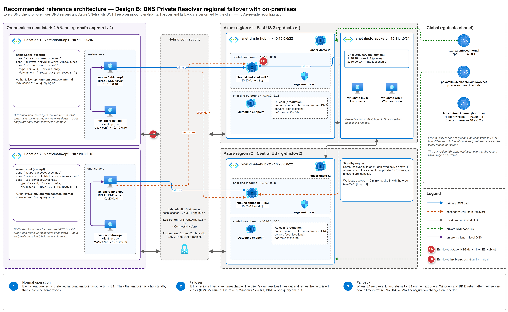

# Azure DNS Private Resolver – regional failover reference architecture

A tested reference architecture and reproducible lab for **regional failover and failback of Azure DNS Private Resolver**. It covers both on-premises DNS servers and Azure VNets.

**Recommended design (Design B):** every DNS client lists **both** resolver inbound endpoints: `[IE r1, IE r2]` for Azure VNets and `forwarders { IE1; IE2; }` for on-premises DNS servers. When the primary region's resolver becomes unreachable, the client's own resolver logic moves to the secondary endpoint. When the primary recovers, the client moves back. Nobody changes DNS settings, rulesets or VNet configuration during an outage.



<sub>Editable source: [reference-architecture-b-onprem.drawio](docs/diagrams/reference-architecture-b-onprem.drawio) · SVG: [reference-architecture-b-onprem.svg](docs/diagrams/reference-architecture-b-onprem.svg)</sub>

## Why Design B

The lab measured four client designs against eleven failure injections. Design B was the only one that kept **100 % query success in every test** and never needed an operator during failover or failback.

| Criterion | **B – custom DNS `[IE1, IE2]`** | Alternatives (A, C, D) |
|---|---|---|
| Survives loss of the r1 inbound endpoint | ✅ 100 % success in every injection | A ❌ 29–95 % · C ⚠️ NXDOMAIN when the ruleset path breaks · D ✅ |
| Failover time | Linux ≈ 5 s · Windows 17–56 s · BIND ≈ one query timeout | D: seconds (resolver-side) |
| Failback | Automatic: Linux on the next query, Windows/BIND after their health timers | D: sticky, 2.5–3 min |
| Same pattern on-premises and in Azure | ✅ A forwarder list on BIND/Windows DNS is the same idea | A, C, D depend on Azure-only rulesets |
| Microsoft Learn alignment | Matches the [resolver failover tutorial](https://learn.microsoft.com/azure/dns/tutorial-dns-private-resolver-failover) | – |
| Moving parts | No ruleset needed for the client path | Rulesets, links and per-spoke targets to maintain |

Trade-off: Design B sends client traffic straight to the hub inbound endpoints, so every spoke (and on-premises) needs a network path to **both** hubs, through peering, a VPN or ExpressRoute. Windows clients also fail over more slowly than Linux.

Full comparison, hypotheses, every result table and fidelity limits: **[docs/design-comparison.md](docs/design-comparison.md)**.

## How failover and failback work

| Phase | Azure VM (spoke B) | On-premises DNS server (BIND) |
|---|---|---|
| **Normal** | Sends queries to IE1 (first DNS server). IE2 is a hot standby that serves the same global private DNS zones. | Forwards to IE1 and IE2. BIND picks forwarders by **measured RTT, not list order**, so the nearer endpoint carries most of the load. |
| **Failover** (IE1 or region r1 unreachable) | The OS resolver times out on IE1 and retries IE2. Linux (`systemd-resolved`/glibc) switches in ≈ 5 s. Windows takes 17–56 s, then stays on IE2. | The timed-out forwarder is marked down and the query is retried on IE2. Clients see one slow answer, then normal latency. |
| **Failback** (IE1 healthy again) | Linux goes back to IE1 on the next query. Windows goes back after its server-priority reset. | BIND prefers IE1 again once its RTT estimate recovers. |

Key requirements:

1. **Private DNS zones are global.** Link every zone (for example `privatelink.*`) to **both** hub VNets so either inbound endpoint answers identically.
2. **Deploy both resolvers active-active.** Give each its own inbound endpoint with a **static IP** so client configuration never changes.
3. **Give every client a network path to both hubs**: spoke peering to hub r1 and hub r2, and hybrid connectivity from on-premises into both regions.
4. **Keep TTLs reasonable.** Caches hide short outages, but a long TTL also delays fixes. The lab caps BIND's cache at 5 s so that failover stays visible.

## Deploy the lab

Prerequisites: PowerShell 7, Azure CLI ≥ 2.60 (Bicep included), Python 3.10+ with `pandas` and `matplotlib`, and Contributor + User Access Administrator on the subscription.

1. Sign in: `az login`
2. Deploy the Azure side, Design B only. A what-if preview runs first and asks you to confirm; deployment takes ≈ 30 minutes:
   ```powershell
   ./scripts/deploy.ps1 -SubscriptionId <sub-id> -Owner <you>
   ```
   Outputs land in `.secrets/lab.env`, which is git-ignored.
   Add `-IncludeComparisonDesigns` to also deploy designs A, C and D (extra spokes, rulesets and an outbound endpoint in r2), so you can reproduce the comparison.
3. *(Optional)* Add the [on-premises extension](#on-premises-extension):
   ```powershell
   ./scripts/deploy-onprem.ps1 -SubscriptionId <sub-id> -Owner <you>                     # VNet peering (default)
   ./scripts/deploy-onprem.ps1 -SubscriptionId <sub-id> -Owner <you> -Connectivity Vpn    # VPN Gateway S2S + BGP
   ```
4. Wait ~5 minutes for role assignments to propagate. Then run a baseline. Results arrive through Log Analytics, typically 2–10 minutes after the run.
   ```powershell
   ./scripts/run-test.ps1 -Failure none -BaselineSec 60 -FailureSec 0 -RecoverySec 0
   ```
5. Run failover and failback experiments (each takes ≈ 10 min):
   ```powershell
   ./scripts/run-test.ps1 -Failure F1a                     # IE1 outage – Azure + on-prem clients
   ./scripts/run-test.ps1 -Failure F1a -OnPremOnly         # on-prem clients only
   ./scripts/run-test.ps1 -Failure onprem-link-break -OnPremOnly
   ./scripts/run-test.ps1 -Failure F4 -FailureSec 300 -RecoverySec 300
   ```
6. Analyse the results:
   ```powershell
   python scripts/analyze.py --all
   ```
   This writes `results/raw/<run>/summary.md`, `timeline.png` and `results/summary.md`.
7. Tear down. This removes the on-premises resource groups too:
   ```powershell
   ./scripts/teardown.ps1 -SubscriptionId <sub-id>
   ```

> [!IMPORTANT]
> Every VM has a DevTest Labs auto-shutdown schedule (`enableAutoShutdown`, default 03:00 UTC). A run that spans the shutdown time produces empty results. Start the VMs before testing (`az vm start --ids $(az vm list -g <rg> --query [].id -o tsv)`). Then either schedule runs around the shutdown time or deploy with `enableAutoShutdown=false` for long sessions.

Cost: ≈ $1.1/hour for Design B only. The resolver endpoints dominate the cost; see [docs/cost.md](docs/cost.md). **Tear down when done.**

## On-premises extension

`scripts/deploy-onprem.ps1` deploys `infra/onprem.bicep`, which emulates two on-premises locations as VNets:

| Location | VNet | Region | DNS server (BIND 9) | Forwarders for Azure zones |
|---|---|---|---|---|
| Location 1 | `vnet-dnsfo-op1` 10.110.0.0/16 | East US 2 | `vm-dnsfo-bind-op1` 10.110.0.10 | `10.10.0.4; 10.20.0.4;` |
| Location 2 | `vnet-dnsfo-op2` 10.120.0.0/16 | Central US | `vm-dnsfo-bind-op2` 10.120.0.10 | `10.20.0.4; 10.10.0.4;` |

Each location also has a Linux client probe (`vm-dnsfo-lnx-op1/op2`). The probe's `resolv.conf` points only at its local BIND server, the same way a workstation would be set up on-premises. BIND is authoritative for `opN.onprem.contoso.internal`, uses `forward only` for `azure.contoso.internal`, `privatelink.blob.core.windows.net` and `lab.contoso.internal`, and caps its cache at 5 s.

| `-Connectivity` | What it builds | Cost | Deploy time |
|---|---|---|---|
| **`Peering`** (default, recommended for the lab) | Each location VNet peers to **both** hub VNets | ≈ $0.04/h + per-GB peering charges | ≈ 5 min |
| `Vpn` | One VpnGw1AZ in each hub and each location, with S2S IPsec + BGP (ASN 65511/65512 hubs, 65521/65522 sites), each location connected to both hubs | ≈ +$0.85–0.90/h | ≈ 45 min |

Peering is cheaper and faster, and it tests the same DNS behaviour: what matters is that BIND can reach both inbound endpoints. Use `Vpn` when you also want to see VPN path behaviour. In production, use ExpressRoute and/or S2S VPN into **both** regions.

> [!NOTE]
> - **BIND chooses forwarders by RTT, not list order.** Both inbound endpoints carry load in normal operation, so don't expect "all traffic on IE1" from on-premises.
> - **Azure → on-premises resolution is not wired in the lab.** Production needs an outbound endpoint plus a forwarding ruleset (`onprem.contoso.internal → both on-prem DNS servers`) in each region. The diagram shows this, but the lab doesn't deploy it because the failover tests only exercise on-prem → Azure.
> - **VPN mode adds a `GatewaySubnet` to each hub.** If you later re-run `deploy.ps1`, that subnet is removed from the hub VNets. Re-run `deploy-onprem.ps1 -Connectivity Vpn` afterwards, or tear down the on-prem extension first.

## Failure injections (`scripts/inject.ps1`)

| ID | What it does | Primarily affects |
|---|---|---|
| **F1a** | NSG deny UDP+TCP 53 inbound on the r1 inbound-endpoint subnet (**main failover test**) | All clients that use IE1, including on-prem BIND |
| F1b | NSG deny 53 outbound to IE r1 on one spoke | ⚠️ **Not enforced in our tests**; use F2/F3 instead |
| F1c | F1a + deny 53 outbound on r1 outbound-endpoint subnets ("region-wide resolver loss") | All, including the ruleset-based designs |
| F2 | UDR `IE r1/32 → None` on one spoke | Direct client → IE |
| F3 | Remove spoke ↔ hub r1 peering | Direct client → IE |
| F4 | Delete the r1 inbound endpoint, then recreate it with the same IP | All (real removal) |
| F5u / F5t | F1a for UDP only / TCP only | UDP vs TCP behaviour |
| F6 | Unlink the spoke ruleset from spoke C | Comparison designs only |
| **onprem-link-break** | Delete the Location 1 ↔ hub r1 peering, then recreate it | On-prem hybrid-link loss |

Each run writes a UTC event log (`events.csv`) and per-VM probe CSVs. The analyzer derives the baseline, failure and recovery phases from the event log.

## Results

Measured in the lab (Design B, default client settings). The full tables are in [results/summary.md](results/summary.md).

| Scenario | Clients | Success during failure | Time to answer from r2 | Failback |
|---|---|---|---|---|
| F1a – r1 inbound endpoint blocked | Azure Linux (systemd-resolved) | 100% | ≈4.6 s worst gap | Automatic |
| F1a – r1 inbound endpoint blocked | Azure Windows | 100% | 17–56 s worst gap (OS cache/retry) | Automatic |
| F5u – r1 resolver unreachable | Azure Linux / Windows | 100% | 8.8 s / 27.4 s worst gap | Automatic |
| F1a – via on-prem BIND | On-prem Location 1 and 2 | 100% | ≈0.5 s (BIND retries the second forwarder) | Automatic |
| onprem-link-break – Location 1 ↔ hub r1 peering deleted | On-prem Location 1 and 2 | 100% via BIND | ≈0.4 s | ≈0.3 s after the peering is restored |

Notes:

- During the link break, direct queries from Location 1 to `10.10.0.4` timed out, as expected. Queries through the on-prem BIND forwarder never failed, because BIND moved to `10.20.0.4`.
- `host.onprem.contoso.internal` returns NXDOMAIN in every phase. This is a known probe artifact (the probe queries a name that doesn't exist in the lab zone), not a failover problem.
- Designs A, C and D were measured against the same failures. See [docs/design-comparison.md](docs/design-comparison.md) for why they weren't selected.

## Documentation

| Document | Audience |
|---|---|
| [Design comparison](docs/design-comparison.md) | Architects: why B, the A/C/D results, hypotheses, recommendations |
| [Blog post](docs/blog-post.md) | General audience: narrative summary |
| [Microsoft Learn doc feedback](docs/doc-feedback.md) | Doc owners: gaps found while building the lab |
| [Results summary](results/summary.md) | Per-run tables generated by `scripts/analyze.py` |
| [Cost](docs/cost.md) | Hourly cost of the default and optional components |

## Repository layout

```
infra/          main.bicep (Azure side, subscription scope), onprem.bicep (on-prem extension), modules/
scripts/        deploy, deploy-onprem, teardown, inject, run-test, collect, analyze, probe/ (Linux + Windows probes)
results/raw/    per-run CSVs, summaries and charts
docs/           design comparison, blog post, doc feedback, cost, diagrams/ (draw.io sources + PNG/SVG)
```

Lab-only shortcut (not for production): subnets set `defaultOutboundAccess: true` so VMs can install packages and reach the Log Analytics ingestion endpoint without a NAT gateway. VMs have no public IPs; access is through `az vm run-command`. Each VM's managed identity sends its probe results to the `DnsProbe_CL` table through the Logs Ingestion API (no keys), and `scripts/collect.ps1` pulls them back. The lab uses no storage account, so it also works where policy forces storage `publicNetworkAccess: Disabled`.
