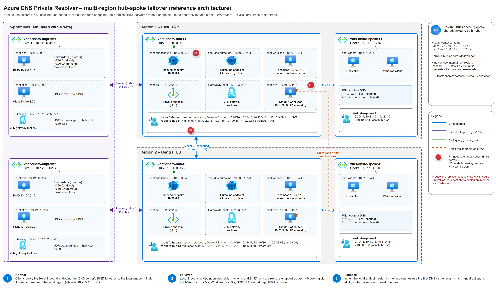

# Azure DNS Private Resolver — Multi-Region Failover Reference Architecture


> [!IMPORTANT]
> **TL;DR**
> - **Problem:** Azure DNS Private Resolver is zone-redundant but **single-region**. If a hub's resolver becomes unreachable, every spoke that points to it loses private DNS.
> - **Pattern:** set each spoke's custom DNS to **both** regional inbound endpoints, local one first. Clients fail over to the other region on their own, then fail back. No probes, record changes or runbooks.
> - **Requirement:** in a CAF hub-spoke, spokes need a routed path to the remote hub. Here, a router (NVA) and UDRs in each hub provide it.
> - **Measured:** failover gap is ≈ 5.5 s on Linux, < 1 s on Windows and 1–2 s on BIND. Failback is automatic, though Windows can stay on the remote resolver for about 110 s.
> - **Try it:** about 30 min to deploy and about $1.25/h to run. See [Quick start](#7-quick-start).

This repository is a **reference architecture** for multi-region [Azure DNS Private Resolver](https://learn.microsoft.com/azure/dns/dns-private-resolver-overview) and a **reproducible lab** that proves it. With the lab you can:

- **Deploy** a two-region hub-spoke aligned with the Cloud Adoption Framework (CAF), with optional emulated on-premises sites.
- **Break things on purpose:** block a resolver, cut the hub-to-hub peering, stop a router, or disconnect an on-premises site.
- **Measure** failover and failback, second by second, for Linux, Windows and BIND clients.

> [!NOTE]
> The Microsoft Learn [DNS failover tutorial](https://learn.microsoft.com/azure/dns/tutorial-dns-private-resolver-failover) covers failover **from on-premises only**. This lab adds **Azure-to-Azure** failover. See [Why this lab exists](#1-why-this-lab-exists).



<sub>Source: [`reference-architecture.drawio`](docs/diagrams/reference-architecture.drawio) · [SVG](docs/diagrams/reference-architecture.svg) · generated by [`build_reference_architecture.py`](docs/diagrams/build_reference_architecture.py)</sub>

---

## Table of contents

1. [Why this lab exists](#1-why-this-lab-exists)
2. [At a glance](#2-at-a-glance)
3. [Architecture](#3-architecture)
   - [Why hub-spoke with NVA routers](#why-hub-spoke-with-nva-routers)
   - [Address plan](#address-plan)
   - [Routing](#routing)
   - [DNS components](#dns-components)
4. [How failover and failback work](#4-how-failover-and-failback-work)
5. [Measured results](#5-measured-results)
6. [Cost to run the lab](#6-cost-to-run-the-lab)
7. [Quick start](#7-quick-start)
8. [On-premises extension](#8-on-premises-extension)
9. [Failure injections](#9-failure-injections)
10. [Best practices for production](#10-best-practices-for-production)
11. [Further reading](#11-further-reading)
12. [Repository layout](#12-repository-layout)
13. [Lab shortcuts (not for production)](#13-lab-shortcuts-not-for-production)

---

## 1. Why this lab exists

### What the Microsoft Learn tutorial covers

[Tutorial: Set up DNS failover using private resolvers](https://learn.microsoft.com/azure/dns/tutorial-dns-private-resolver-failover) removes a single point of failure **in on-premises DNS**. It deploys one resolver in each of two regions. Then it configures the **on-premises DNS server** with a conditional forwarder that lists both inbound endpoints. If one region's endpoint stops answering, the on-premises server retries the other one.

The tutorial is scoped deliberately:

- Its scenario is two on-premises locations, each with a primary connection to its local hub and a **secondary connection to the other hub**.
- The Azure VNets keep **Default (Azure-provided)** DNS. The tutorial says that custom DNS settings "can also be made to work, but this is not in scope".
- The failure it demonstrates is a **broken on-premises-to-Azure connection**.

### What it leaves out: Azure workloads

Many enterprise landing zones use the centralized DNS pattern from [Private resolver architecture](https://learn.microsoft.com/azure/dns/private-resolver-architecture#centralized-dns-architecture). Each spoke VNet's **custom DNS server is the hub resolver's inbound endpoint** (for example `10.10.0.4`). This means every Azure VM, AKS node and App Service with VNet integration in that spoke sends its DNS queries to that single regional endpoint.

So what happens to those **Azure** workloads if the regional resolver becomes unreachable?

- **Availability-zone failures are already handled.** DNS Private Resolver is [zone-redundant automatically](https://learn.microsoft.com/azure/reliability/reliability-dns-private-resolver#resilience-to-availability-zone-failures) in regions that support availability zones, at no extra cost and with no configuration. A zone outage is absorbed inside the region.
- **Region-level problems aren't.** The resolver is [a single-region service](https://learn.microsoft.com/azure/reliability/reliability-dns-private-resolver#resilience-to-region-wide-failures). A regional outage, a misconfigured NSG or UDR on the endpoint subnet, or a deleted or broken endpoint all leave the spoke with no DNS server that answers. The reliability guide recommends a second resolver in another region, and links back to the on-premises-only tutorial for the steps.

Neither document explains how to give **Azure-hosted clients** a second, cross-region DNS server, or what that does to routing in a hub-spoke design. This lab fills that gap.

### What this lab adds

| | Microsoft Learn tutorial | This lab |
|---|---|---|
| **Who fails over** | On-premises DNS servers (conditional forwarders) | Azure spoke workloads (Linux and Windows VMs) **and** on-premises BIND servers |
| **Azure VNet DNS setting** | Default (Azure-provided) | Custom DNS with **both** inbound endpoints, local endpoint first |
| **Topology** | Two hub VNets, each with its own hybrid link | CAF multi-region hub-spoke: hubs peered globally, spokes peered to their own hub only |
| **Cross-region path to the standby resolver** | Not needed (on-premises has a link to each hub) | Required: spoke → local hub NVA → remote hub NVA → remote resolver, through UDRs |
| **Failures tested** | Disconnecting one on-premises link | Resolver endpoint blocked, hub-to-hub peering lost, router down, endpoint deleted, UDP-only and TCP-only loss, on-premises link break |
| **What is measured** | Whether `nslookup` still works | Per-second probes: failover gap, time on the standby resolver, failback time, per OS and per resolver stack |

In short, the tutorial answers: *"If on-premises loses one path to Azure, does it still resolve Azure private names?"* This lab answers: *"If an Azure region's resolver goes away, do the Azure workloads in that region still resolve names? How quickly do they fail over, and do they come back on their own?"*

> [!TIP]
> The [on-premises extension](#8-on-premises-extension) reproduces the tutorial's forwarder-based failover with BIND. It shows the other side of the tutorial's design: a site with a **single** link to one hub has no DNS failover path (≈ 180 s outage in the link-break test). That is why the tutorial gives each site a secondary connection to the other hub.

---

## 2. At a glance

| | |
|---|---|
| **Topology** | Two regional hubs (East US 2, Central US). Each hub has one spoke. Global peering connects the two hubs only. |
| **Cross-region routing** | One Linux NVA router per hub. Spoke and hub UDRs send traffic for the other region to the local NVA, and the NVA forwards it to the NVA in the other hub. |
| **DNS** | One DNS Private Resolver per hub, each with an inbound and an outbound endpoint. Private DNS zones are linked to **both** hubs. |
| **Client DNS settings** | r1 spoke → `10.10.0.4, 10.20.0.4`; r2 spoke → `10.20.0.4, 10.10.0.4` (the local endpoint is listed first). |
| **On-premises (optional)** | Two emulated sites with BIND. Each site attaches to its regional hub only, over VNet peering (default) or VPN with BGP. |
| **Failover time** | Linux ≈ 5.5 s · Windows < 1 s gap · BIND ≈ 1–2 s (see [results](#5-measured-results)) |
| **Lab cost** | ≈ $1.25/h (≈ $30/day) for the core lab (see [cost](#6-cost-to-run-the-lab)) |
| **Deploy time** | ≈ 30 min core lab · +5 min on-prem (peering) or +45 min (VPN) |

---

## 3. Architecture

### Why hub-spoke with NVA routers

The Azure guidance for multi-region networks is a hub-spoke per region, with the two **hubs** peered to each other. Spokes peer **only with their own hub**. Peering isn't transitive, so a spoke can't reach the other region on its own. Traffic between regions is sent through a routing appliance in the hub (Azure Firewall or an NVA) by user-defined routes (UDRs).

- [Use Azure Firewall to route a multi hub and spoke topology](https://learn.microsoft.com/azure/firewall/firewall-multi-hub-spoke#multi-region-hub-and-spoke-architecture)
- [Hub-spoke network topology in Azure — recommendations](https://learn.microsoft.com/azure/architecture/networking/architecture/hub-spoke#recommendations)
- [Spoke-to-spoke communication patterns](https://learn.microsoft.com/azure/architecture/reference-architectures/hybrid-networking/virtual-network-peering#spoke-to-spoke-communication-patterns)
- [Cross-region connectivity design considerations](https://learn.microsoft.com/azure/networking/design-guide/cross-region#design-considerations)

The lab follows that guidance. It uses a small Linux VM with IP forwarding (`vm-dnsfo-nva-rN`) as the routing component, which keeps the cost low and makes the routing easy to inspect.

> [!WARNING]
> **The single NVA per hub is a lab simplification and a single point of failure.** In production, use Azure Firewall, or a pair of NVAs behind an internal Standard Load Balancer with HA ports. Failure F3 below shows what happens when the NVA goes down.

### Address plan

| Component | Region 1 — East US 2 | Region 2 — Central US |
|---|---|---|
| Hub VNet | `10.10.0.0/22` | `10.20.0.0/22` |
| Resolver inbound endpoint | **`10.10.0.4`** | **`10.20.0.4`** |
| NVA router | `10.10.3.68` | `10.20.3.68` |
| Spoke VNet | `10.11.0.0/16` | `10.21.0.0/16` |
| On-prem site (optional) | `10.110.0.0/16` | `10.120.0.0/16` |

### Routing

| Route table | Attached to | Routes |
|---|---|---|
| `rt-dnsfo-spoke-rN` | Spoke workload subnets | Other region's hub, spoke and on-prem ranges → **local NVA** |
| `rt-dnsfo-hub-rN` | Hub subnets (resolver endpoints, shared services) | Other region's ranges → **local NVA** |
| `rt-dnsfo-hub-rN-nva` | NVA subnet | Other region's ranges → **remote NVA** (across the hub-to-hub peering) |
| `rt-dnsfo-opN` | On-prem site subnets (Peering mode) | Azure and other-site ranges → **regional NVA** |

Every peering sets `allowForwardedTraffic`, so packets the NVAs forward are accepted at the far end.

### DNS components

| Resource | Purpose |
|---|---|
| Private DNS zones `azure.contoso.internal`, `lab.contoso.internal`, `privatelink.blob.core.windows.net` | Linked to **both** hub VNets, so either resolver can answer every query. |
| DNS Private Resolver per hub (inbound + outbound endpoints) | Both are active. Each inbound endpoint has a static IP (`.0.4`). |
| DNS forwarding ruleset per region | Forwards `onprem.contoso.internal` to the on-prem BIND servers (on-prem extension only). |
| `lab.contoso.internal/whoami` | Each region gets a different answer (`10.255.1.1` / `10.255.2.2`), so the probes can tell which resolver replied. |

---

## 4. How failover and failback work

Failover is client-side: the client walks its list of DNS servers. Nothing in Azure has to detect the outage or change configuration.

| Phase | Linux (systemd-resolved) | Windows DNS Client | On-prem BIND forwarder |
|---|---|---|---|
| **Normal** | Queries the first server (local inbound endpoint). The remote endpoint is a hot standby. | Same | Picks the forwarder with the lowest smoothed RTT. |
| **Failover** | After ≈ 5 s of timeouts it switches to the next server and stays there. | Retries the next server within about a second, then keeps preferring it for a while (≈ 110 s in this lab). Earlier runs measured 17–56 s, so plan for the worst case. | Marks the forwarder down within one query timeout (< 1 s). |
| **Failback** | Goes back to the first server once it answers again (on the next query or retry cycle). | Returns once its server-priority reset happens (about every 15 minutes, or on a network change). | Goes back as the RTT of the recovered forwarder improves. |

```text
 Spoke r1 client ──(1) 10.10.0.4 ✔──► Resolver r1                         normal
 Spoke r1 client ──(1) 10.10.0.4 ✖
                 └─(2) 10.20.0.4 ──► NVA r1 ─► NVA r2 ─► Resolver r2      failover
```

> [!NOTE]
> Client behavior in this table was **observed in the lab**, not taken from a specification. Resolver libraries and OS versions differ, so measure your own client mix with the probes in this repo before you commit to an RTO.

---

## 5. Measured results

Measured on this topology in an Azure test subscription. The raw data is in [`results/raw/`](results/raw/) and the analysis in [`results/summary.md`](results/summary.md).

<!-- RESULTS-TABLE -->
| Test | What fails | Clients using the OS resolver / BIND | Failback |
|---|---|---|---|
| **F1a** – primary inbound endpoint blocked (NSG deny 53) | Resolver r1 | **100 % success.** Linux: max gap ≈ 5.5 s, on r2 after ≈ 8.5 s. Windows: max gap < 1 s, stays on r2 ≈ 110 s. On-prem BIND: 0.5–1.8 s. r2 clients unaffected. | Linux immediate · Windows 0.3–39 s · BIND < 1 s |
| **F2** – hub ↔ hub peering deleted | Cross-region path | **100 % success**, gaps 0.5–1.4 s. Only direct queries to the remote endpoint fail. | ≤ 0.5 s |
| **F3** – r1 NVA deallocated | Cross-region router | **100 % success**, gaps 0.5–1.4 s (one 7.5 s Windows SRV gap). Only direct queries to the remote endpoint fail. | ≤ 0.5 s |
| **On-prem link break** – site 1 ↔ hub r1 | Site 1's only hybrid link | **Site 1 lost Azure private names for the whole fault (≈ 180 s).** Internet names kept working. Site 2 unaffected. | Immediate |

**Takeaways**

- Each region resolves locally, so losing the hub peering or a router never breaks DNS for clients. It only removes the standby path.
- A resolver outage is absorbed by client-side failover in seconds.
- An on-prem site with a single link to one hub has **no DNS failover path**. In production, use redundant ExpressRoute/VPN connections, or connect each site to both regional hubs.
<!-- /RESULTS-TABLE -->

---

## 6. Cost to run the lab

Indicative pay-as-you-go **list prices in USD**, taken from the [Azure Retail Prices API](https://learn.microsoft.com/rest/api/cost-management/retail-prices/azure-retail-prices) and the [Azure DNS pricing page](https://azure.microsoft.com/pricing/details/dns/) when the lab was built. Prices change and vary by region and agreement, so check the [Azure pricing calculator](https://azure.microsoft.com/pricing/calculator/) before you deploy.

| Deployment | What it adds | ≈ per hour | ≈ per day |
|---|---|---|---|
| **Core lab** (`deploy.ps1`) | 2 resolvers (2 inbound + 2 outbound endpoints), 2 rulesets, 6 Linux VMs (2 NVAs, 2 clients, 2 dnsmasq), 2 Windows clients, zones, Log Analytics | **$1.25** | **$30** |
| Core lab without Windows (`-p deployWindows=false`) | Same, minus the 2 Windows VMs | $1.08 | $26 |
| + On-prem extension, **peering** (default) | 4 Linux VMs (2 BIND, 2 clients), 2 peerings | +$0.04 | +$1 |
| + On-prem extension, **VPN** | Same VMs plus 4 × `VpnGw1AZ` gateways and public IPs | +$0.85 to +$0.90 | +$21 |

**Where the money goes:** the four resolver endpoints (≈ $0.98/h) are about 80 % of the core lab cost. They are billed per endpoint per hour, **whether or not the VMs are running**. Auto-shutdown and deallocating VMs only save the VM part.

> [!IMPORTANT]
> **Tear the lab down when you finish** (`scripts/teardown.ps1`). Leaving it deployed with the VMs stopped still costs ≈ $1/h. A typical test session (deploy, baseline, three failure tests, analysis, teardown) takes 2–3 hours, or roughly **$3–4**.

The full breakdown is in [docs/cost.md](docs/cost.md).

---

## 7. Quick start

### Prerequisites

- PowerShell 7+
- Azure CLI 2.60 or later
- Python 3.10+ with `pandas` and `matplotlib`
- Contributor and User Access Administrator on the target subscription
- Quota for about 8 B-series vCPUs in each region (12 with the on-prem extension)

### Deploy and test

```powershell
# 1. Sign in
az login

# 2. Deploy the hub-spoke lab (shows a what-if preview first; takes about 30 min)
pwsh scripts\deploy.ps1 -SubscriptionId <sub-id> -Owner you@contoso.com

# 3. (Optional) add the emulated on-premises sites
pwsh scripts\deploy-onprem.ps1 -SubscriptionId <sub-id> -Owner you@contoso.com -Connectivity Peering

# 4. Wait about 5 minutes for the probes to start, then run a baseline
pwsh scripts\run-test.ps1 -Failure none -BaselineSec 60 -FailureSec 0 -RecoverySec 0

# 5. Run failover/failback experiments
pwsh scripts\run-test.ps1 -Failure F1a
pwsh scripts\run-test.ps1 -Failure F1a -OnPremOnly

# 6. Analyze
python scripts\analyze.py --all

# 7. Tear down
pwsh scripts\teardown.ps1 -SubscriptionId <sub-id>
```

> [!IMPORTANT]
> By default every VM shuts down automatically at **03:00 UTC** (`enableAutoShutdown`). Start the VMs again before running tests the next day.

Useful deployment parameters: `-p deployWindows=false` skips the Windows clients (saves ≈ $0.17/h). `primaryLocation` and `secondaryLocation` change the regions.

---

## 8. On-premises extension

`infra/onprem.bicep` (deployed with `scripts/deploy-onprem.ps1`) adds two emulated datacenters. Each one attaches **only to its own regional hub**, which is how a real branch connects through its nearest ExpressRoute or VPN location.

| Site | Region | Address space | BIND server | Client | Preferred forwarder |
|---|---|---|---|---|---|
| on-prem 1 | East US 2 | `10.110.0.0/16` | `10.110.0.10` | `10.110.1.20` | `10.10.0.4`, then `10.20.0.4` |
| on-prem 2 | Central US | `10.120.0.0/16` | `10.120.0.10` | `10.120.1.20` | `10.20.0.4`, then `10.10.0.4` |

BIND uses `forward only` for the three Azure zones and lists **both** inbound endpoints as forwarders. It also hosts `onprem.contoso.internal`, which the Azure outbound endpoints reach through the forwarding rulesets.

| `-Connectivity` | How the site connects | Deploy time | Extra cost |
|---|---|---|---|
| `Peering` (default) | VNet peering to the regional hub, plus a UDR to the regional NVA | ≈ 5 min | ≈ $0.04/h |
| `Vpn` | S2S VPN with BGP (VpnGw1AZ in hub and site, ASNs 65511/65512 ↔ 65521/65522) | ≈ 45 min | ≈ $0.85–0.90/h |

Notes:

- BIND chooses between forwarders by RTT, not by their order in the list. Failover is therefore nearly instant: it skips a dead forwarder after one timeout.
- VPN mode adds a `GatewaySubnet` to each hub. Running `deploy.ps1` again removes it, so redeploy the on-prem extension afterwards.

---

## 9. Failure injections

`scripts/run-test.ps1 -Failure <id>` follows a baseline → fault → recovery timeline. All faults affect **region 1 only**.

| ID | What it breaks | What it shows |
|---|---|---|
| `F1a` | NSG denies TCP/UDP 53 on the r1 inbound-endpoint subnet | Regional resolver outage → failover to r2 and failback |
| `F1c` | F1a plus blocks the r1 outbound-endpoint subnet | Outage including on-prem forwarding |
| `F2` | Deletes and recreates the hub-to-hub peering | Remote path lost; clients keep resolving through their local resolver |
| `F3` | Deallocates the r1 NVA | Router failure; remote endpoint unreachable through r1 |
| `F4` | Deletes and recreates the r1 inbound endpoint | Control-plane loss of the endpoint (same static IP restored) |
| `F5u` / `F5t` | Like F1a, but UDP only / TCP only | Protocol-specific behavior (TCP fallback) |
| `onprem-link-break` | Breaks the on-prem site 1 ↔ hub r1 link | Shows that a site's single hub link is a single point of failure for Azure private names |

Useful switches: `-LinuxProfile resolved-default|glibc-default|glibc-tuned`, `-Repeat N`, `-NoWindows`, `-NoOnPrem`, `-OnPremOnly`.

> [!TIP]
> **Why an NSG?** You can't stop a managed resolver on demand. An NSG rule that denies port 53 on the inbound-endpoint subnet looks exactly like an unreachable resolver to clients, and it's reversible in seconds. Use the same technique for game-day tests in a non-production environment.

---

## 10. Best practices for production

These recommendations come from the lab results and the linked Microsoft Learn guidance. Treat them as a checklist when you design multi-region private DNS.

### Resolver design

| Practice | Why it matters |
|---|---|
| **Deploy a resolver in every region that hosts workloads, and run them active-active.** | The resolver is zone-redundant but [single-region](https://learn.microsoft.com/azure/reliability/reliability-dns-private-resolver#resilience-to-region-wide-failures). A second region is the only protection against a regional fault. |
| **Use static IP addresses for inbound endpoints.** | These IPs are written into VNet DNS settings and on-premises forwarders. A [static address](https://learn.microsoft.com/azure/dns/private-resolver-endpoints-rulesets#static-and-dynamic-endpoint-ip-addresses) survives endpoint re-creation (see F4). |
| **Give each endpoint its own delegated subnet, /28 at minimum.** | Endpoints can't share a subnet, and the subnet must be [between /28 and /24](https://learn.microsoft.com/azure/dns/dns-private-resolver-overview#subnet-restrictions) and delegated to `Microsoft.Network/dnsResolvers`. |
| **Size for the per-endpoint limit.** | Each endpoint handles up to [10,000 QPS](https://learn.microsoft.com/azure/dns/dns-private-resolver-overview#restrictions). During failover, one endpoint receives **both** regions' load, so plan capacity for the combined peak. |

### Client DNS configuration

| Practice | Why it matters |
|---|---|
| **List the local inbound endpoint first and the remote one second** in each spoke's custom DNS servers. | Clients normally stay in-region (lower latency, no cross-region data charges) and fail over only when the local endpoint stops answering. |
| **Make sure every DNS server in the list returns the same answers.** | Clients treat the servers as interchangeable. Link every private DNS zone, including `privatelink.*` zones, to **both** hubs, or failover returns NXDOMAIN. |
| **Renew DHCP leases after changing VNet DNS servers.** | VMs pick up a new DNS server list only after a [DHCP lease renewal or restart](https://learn.microsoft.com/azure/virtual-network/virtual-networks-faq#name-resolution-dns). |
| **Keep client timeouts short and TTLs balanced.** | Microsoft recommends a [2–5 s DNS client timeout](https://learn.microsoft.com/azure/reliability/reliability-dns-private-resolver#resilience-to-transient-faults). Very low TTLs add load and more chances to hit a fault. Very high TTLs keep stale answers after a change. |
| **Know your clients' failback behavior.** | Windows kept using the secondary for up to ≈ 110 s after recovery in this lab. That is harmless for correctness but means cross-region traffic continues for a while. |

### Network path to the standby resolver

| Practice | Why it matters |
|---|---|
| **Treat the cross-region router as part of the DNS path.** | The standby resolver is only useful if spokes can reach it. Use Azure Firewall or highly available NVAs, not a single VM. |
| **Allow both UDP and TCP 53** to the inbound endpoint subnets in NSGs and firewalls. | DNS falls back to TCP for large responses. Blocking only one protocol produces partial failures that are harder to diagnose; use the `F5u`/`F5t` injections to reproduce them. |
| **Enable `allowForwardedTraffic` on every peering, and keep routing symmetric.** | Forwarded packets are dropped without it. Asymmetric return paths through stateful firewalls break DNS replies. |

### Hybrid (on-premises) connectivity

| Practice | Why it matters |
|---|---|
| **Configure on-premises forwarders with both inbound endpoints.** | This is the pattern in the [Microsoft Learn tutorial](https://learn.microsoft.com/azure/dns/tutorial-dns-private-resolver-failover). |
| **Give every site a path to both regions** (redundant ExpressRoute/VPN, or a secondary connection to the other hub). | With a single link, the lab's site lost all Azure private names for the full ≈ 180 s outage. |
| **Keep forwarding rulesets identical in both regions,** and deploy them from the same IaC. | After failover, queries from Azure to on-premises go through the other region's outbound endpoint and ruleset. |

### Monitoring and operations

| Practice | Why it matters |
|---|---|
| **Alert on the resolver's per-endpoint *Queries Per Second* metric.** | The [`Microsoft.Network/dnsResolvers` metrics](https://learn.microsoft.com/azure/azure-monitor/reference/supported-metrics/microsoft-network-dnsresolvers-metrics) can be split by endpoint. A sudden drop on the primary and a rise on the secondary is a clear failover signal. |
| **Set up Resource Health and Service Health alerts.** | Microsoft [doesn't notify you automatically](https://learn.microsoft.com/azure/reliability/reliability-dns-private-resolver#behavior-during-a-zone-failure) when a resolver is impaired. |
| **Log DNS queries with a DNS security policy.** | [`DNSQueryLogs`](https://learn.microsoft.com/azure/dns/dns-traffic-log-how-to#view-and-test-dns-logs) in Log Analytics shows which clients query which names, which is useful for checking that failback finished. |
| **Run synthetic DNS probes from each spoke and site.** | Platform metrics don't show what a client experiences. The lab's probes (`scripts/probe/`) are a template. |
| **Test failover regularly, and keep everything in IaC.** | Multi-region failover is a [customer-built solution](https://learn.microsoft.com/azure/reliability/reliability-dns-private-resolver#custom-multiregion-solutions-for-resiliency), so test it. The resolver stores no data; recovery means [redeploying from templates](https://learn.microsoft.com/azure/reliability/reliability-dns-private-resolver#backup-and-restore). |

---

## 11. Further reading

**In this repository**

| Document | What's inside |
|---|---|
| [Why this design](docs/why-this-design.md) | Comparison of the four candidate designs (A–D), with the measurements that led to this reference architecture |
| [Results summary](results/summary.md) | Per-run failover/failback tables and charts |
| [Cost](docs/cost.md) | Hourly cost breakdown and ways to save |
| [Blog post](docs/blog-post.md) | A narrative walkthrough of the findings |
| [Documentation feedback](docs/doc-feedback.md) | Suggested improvements to the public Microsoft Learn tutorial |

**Microsoft Learn**

- [What is Azure DNS Private Resolver?](https://learn.microsoft.com/azure/dns/dns-private-resolver-overview)
- [Private resolver architecture](https://learn.microsoft.com/azure/dns/private-resolver-architecture)
- [Tutorial: Set up DNS failover using private resolvers](https://learn.microsoft.com/azure/dns/tutorial-dns-private-resolver-failover)
- [Reliability in Azure DNS Private Resolver](https://learn.microsoft.com/azure/reliability/reliability-dns-private-resolver)
- [Name resolution for resources in Azure virtual networks](https://learn.microsoft.com/azure/virtual-network/virtual-networks-name-resolution-for-vms-and-role-instances)
- [Hub-spoke network topology in Azure](https://learn.microsoft.com/azure/architecture/networking/architecture/hub-spoke)

---

## 12. Repository layout

```text
infra/               Bicep: main.bicep (hub-spoke lab), onprem.bicep (on-prem extension), modules/
scripts/             deploy, deploy-onprem, run-test, inject, collect, analyze, teardown
scripts/probe/       DNS probe agents (Linux: probe.py, Windows: probe.ps1)
results/raw/         One folder per experiment run (events.csv, timeline, metadata)
results/summary.md   Generated analysis
docs/                Design rationale, cost, blog post, diagrams
```

---

## 13. Lab shortcuts (not for production)

- VMs have no public IPs. Use `az vm run-command` to access them. Subnets use `defaultOutboundAccess: true` so package installs work.
- The routers are single Linux VMs (see the warning in [Architecture](#why-hub-spoke-with-nva-routers)).
- Probes send their results to a `DnsProbe_CL` table through the Logs Ingestion API, using managed identity. The lab doesn't use a storage account.
- Every resource has `owner` and `ttl` tags. Delete everything with `scripts/teardown.ps1`.

---

*Analysis only — verify against vendor documentation before applying.*
