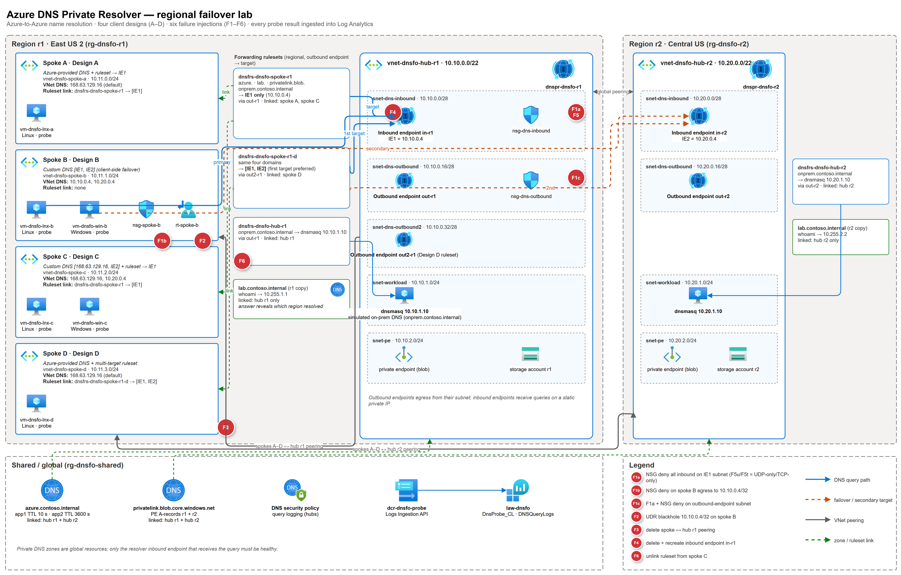

# What happens to your Azure VMs' DNS when the primary DNS Private Resolver goes dark?

*A hands-on test of four client designs, eight failure injections and two operating systems.*

Microsoft Learn shows how **on-premises** DNS servers fail over between two Azure DNS Private Resolver inbound endpoints ([tutorial](https://learn.microsoft.com/azure/dns/tutorial-dns-private-resolver-failover)). The guidance is much thinner for the other common question:

> *My Azure VMs resolve private zones through a resolver in region 1. If that resolver becomes unreachable, do they fail over to region 2 — and how fast do they come back?*

I built a lab to find out. Everything below was **measured** or is **cited** to Microsoft Learn. The full method, tables and caveats are in the [design comparison](design-comparison.md), and the recommended architecture is in the [README](../README.md).

## The setup in one paragraph

Two hubs (eastus2 and centralus), each with a DNS Private Resolver (inbound endpoint `10.10.0.4` / `10.20.0.4`). Four spokes in eastus2, each peered to both hubs, each using a different client design. Ubuntu and Windows VMs query names once per second, both through the OS resolver and directly against each DNS server. A zone that answers differently per region tells us which resolver actually replied. Results are streamed to Log Analytics and analyzed with a script in the repo.

## The four designs

| | Spoke VNet DNS servers | Forwarding |
|---|---|---|
| **A** | Azure-provided (168.63.129.16) | Ruleset → IE r1 only |
| **B** | `IE r1, IE r2` | none |
| **C** | `168.63.129.16, IE r2` | Ruleset → IE r1 |
| **D** | Azure-provided | Ruleset → `IE r1, IE r2` (multi-target rule) |

## How I "broke" the primary resolver

The simplest trick turned out to be the most useful: **an NSG rule denying TCP and UDP 53 on the inbound-endpoint subnet**. The resolver subnet is delegated, but NSGs and UDRs still apply — not documented, but measured here, and fully reversible within seconds. I also tested UDR black holes, peering removal, deleting the inbound endpoint outright, and unlinking a forwarding ruleset.

## What happened

OS-level success for a 10-second-TTL record during a 5-minute failure:

| Failure | A | B | C | D |
|---|---|---|---|---|
| Inbound endpoint r1 blocked (NSG) | 95 % | **100 %** | 100 % | 100 % |
| Same, Linux without a resolver cache | 68 % | **100 %** | 100 % | 99 % |
| Inbound endpoint r1 deleted | **29 %** | **100 %** | 100 % | 100 % |
| Ruleset unlinked from spoke C | 100 % | **100 %** | **5–38 %** | 100 % |

### Takeaways

1. **One target = no failover (A).** 168.63.129.16 forwards to a dead endpoint and the VM gets SERVFAIL, timeouts and eventually NXDOMAIN.
2. **Two inbound endpoints on the VNet (B) is the winner.** The guest OS handles failover. Linux (`systemd-resolved`) moved to r2 in about 5 seconds and stayed there; Windows took longer but never failed a lookup through the OS resolver.
3. **Mixing 168.63.129.16 with a remote IE (C) is a trap.** It works when 168.63.129.16 *times out*, but any misconfiguration that makes it answer **NXDOMAIN** — such as an unlinked ruleset — is final. The client never asks the second server.
4. **Multi-target forwarding rules (D) work — with sticky failback.** The resolver fails over to the second target in seconds, but keeps using it for about 2.5–3 minutes after the primary recovers. That fits the [documented exponential backoff](https://learn.microsoft.com/azure/dns/private-resolver-endpoints-rulesets#dns-forwarding-rulesets). D also depends on the r1 outbound endpoint and ruleset, which are regional resources.
5. **Long TTLs hide outages, they don't fix them.** A 1-hour-TTL record stayed above 96 % even on Design A.
6. **Blocking only UDP is a full outage.** With UDP/53 to the primary blocked and TCP left open, clients timed out instead of retrying over TCP. Each design failed over just as it did for a full block.

## What I'd recommend

- For VMs that need regional DNS resilience, set **both inbound endpoints as the VNet's DNS servers**, local first (Design B).
- If 168.63.129.16 must stay on the VNet, use **multi-target forwarding rules** (Design D), deploy a resolver and ruleset in **each** region, and plan for sticky failback.
- Don't use `[168.63.129.16, remote IE]` as an HA pattern.
- Rehearse with an NSG deny on port 53 **on the inbound-endpoint subnet**. It's cheap and reversible. A deny on the *client* subnet didn't take effect in my tests, so confirm that `dig @<primary IE>` actually fails before you trust the drill.

## Caveats

This is **not** a real regional outage. I can block paths and delete endpoints, but I can't take down a region's control plane or 168.63.129.16 itself. It's one region pair, a few runs per scenario, and default OS settings. Treat the numbers as directional and re-run the lab for your own setup — it's all in the repo, costs about $1.1/hour for Design B only (about $1.5/hour with all four designs), and tears down with one script.

---

*Analysis only — verify against vendor documentation before applying.*
